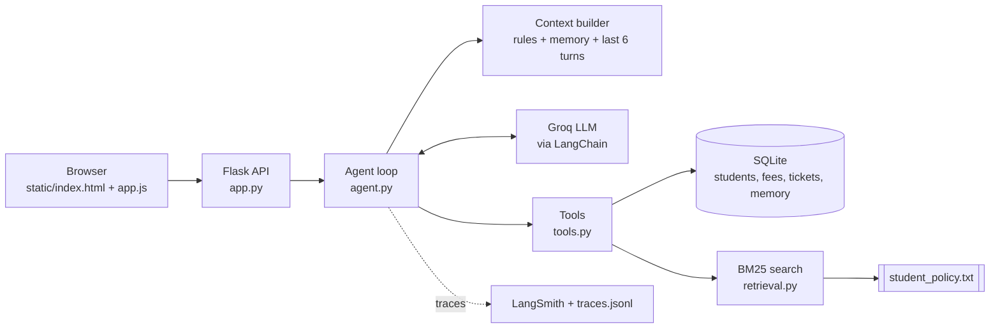
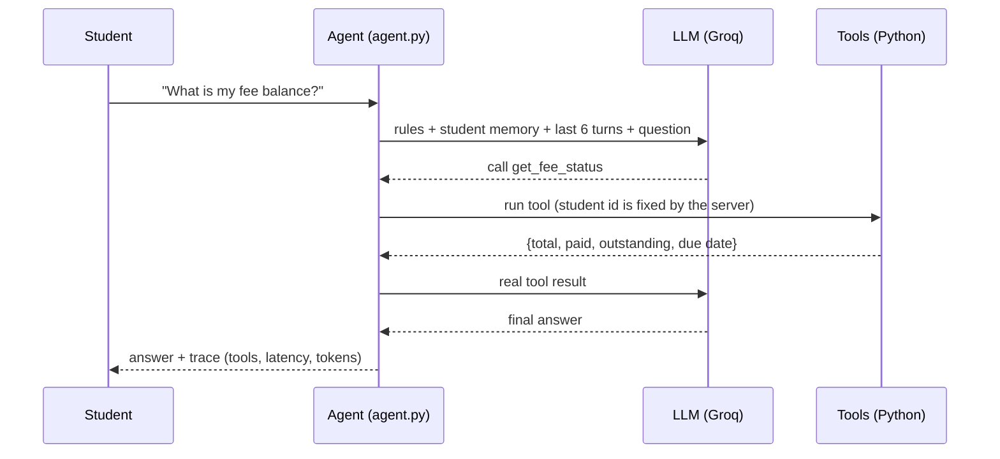

# Student Support Agent (Assignment 1)

**Agentic AI Engineering | PGDM (Big Data Analytics / AI & Data Science), Batch 2025-27**

A chat-style AI assistant for a college student portal. A student logs in and asks about fees, scholarships, policies or support tickets. The agent decides **when to use a tool**, looks up the data, and answers only from what it found. It remembers useful facts between sessions and says so honestly when it does not know something.

> All students, fees and policies in this project are **fictional demo data**.

---

## Features

- **Agent loop**: the model decides if a tool is needed, the tool runs in Python, and the real result goes back to the model before the final answer
- **6 tools**: fee status, scholarship status, create support ticket, search handbook, save memory, read memory
- **Persistent memory** (SQLite): remembers things like "my programme is PGDM"; refuses passwords, card numbers and OTPs
- **Vectorless RAG**: own BM25 keyword search over one handbook. No embeddings and no vector database. Returns only the top 3 relevant sections
- **Honest answers**: if the handbook does not cover something, the agent says so instead of guessing
- **Login** with student ID and password (salted hashes, signed session cookie)
- **Tracing**: every run is logged to `logs/traces.jsonl` and optionally to LangSmith
- **Evaluation**: 13 agent tests plus 9 retrieval tests, with a generated report

---

## How it works



### What happens when a student asks a question



The loop repeats up to `MAX_STEPS` (default 5). Unknown tool names are rejected, and errors come back as controlled messages, never invented answers.

---

## Tools

| Tool | What it does |
|---|---|
| `get_fee_status` | Total fees, paid, outstanding balance and due date for the logged-in student |
| `check_scholarship_status` | Scholarship status and details |
| `create_support_ticket` | Creates a ticket and returns its ID |
| `search_policy` | BM25 search over the handbook, top 3 sections above a relevance threshold |
| `save_memory` | Saves a durable fact (key + value) for this student |
| `get_saved_memory` | Reads this student's saved facts |

The student ID is **bound into the tools by the server**. The tools take no student-ID argument, so the model cannot choose whose record to read.

---

## Memory and context

- Memory lives in SQLite, one row per student and key (for example `programme = PGDM Agentic AI`), and survives a restart.
- Sensitive content (passwords, card numbers, OTPs, long digit strings) is blocked.
- Temporary statements ("I am in a hurry right now") are answered but not stored.
- Each model call receives only: the system rules, that student's saved memory, and the last 6 turns. Policy text and records are fetched by tools on demand, never pasted in whole.

---

## Project structure

```
.
├── app.py               Flask server and API (login, chat, memory, health, evaluator)
├── agent.py             The agent loop
├── tools.py             The 6 tools
├── retrieval.py         BM25 search (no embeddings)
├── memory.py            Persistent memory with safety checks
├── context_manager.py   System rules + memory + recent turns
├── database.py          SQLite schema and seeding
├── tracing.py           LangSmith + JSONL logging
├── evaluate.py          Test runner and report generator
├── config.py            Settings read from .env
├── schemas.py           Response models
├── data/
│   ├── student_policy.txt     The one handbook used for retrieval
│   ├── students.json          Fictional students, fees, scholarships
│   ├── test_cases.json        Agent tests T01-T13
│   └── retrieval_cases.json   Retrieval tests
├── scripts/
│   ├── initialize_db.py       Create / reset the database
│   └── evaluate_with_dashboard.py
├── static/              Chat UI and evaluator dashboard
├── reports/             Generated evaluation report and CSVs
└── logs/traces.jsonl    One JSON line per agent run
```

---

## How to run

### 1. Requirements
- Python 3.10 or newer
- A free Groq API key from <https://console.groq.com>
- (Optional) A LangSmith API key from <https://smith.langchain.com> for tracing

### 2. Install

```bash
git clone <your-repo-url>
cd <your-repo-folder>

python -m venv .venv
# Windows PowerShell:
.venv\Scripts\Activate.ps1
# Windows CMD:
.venv\Scripts\activate.bat
# macOS / Linux:
source .venv/bin/activate

pip install -r requirements.txt
```

### 3. Create a `.env` file in the project folder

```env
GROQ_API_KEY=your_groq_key_here
GROQ_MODEL=openai/gpt-oss-120b
SECRET_KEY=any-long-random-string

# Optional tracing
LANGSMITH_TRACING=true
LANGSMITH_API_KEY=your_langsmith_key_here
LANGSMITH_PROJECT=student-support-agent

MAX_STEPS=5
```

`GROQ_MODEL` can be any current Groq model that supports tool calling. Without LangSmith keys the app still works; tracing is simply off.

> **Never commit your `.env` file.** Add `.env` to `.gitignore` before pushing, and rotate any key that was ever pushed by mistake.

### 4. Create the database

```bash
python scripts/initialize_db.py
```

### 5. Start the app

```bash
python app.py
```

Open <http://127.0.0.1:5000>.

### Demo logins (fictional)

| Student ID | Name | Password |
|---|---|---|
| S101 | Aarav Patel | `aarav@123` |
| S102 | Priyansh Shah | `priyansh@123` |
| S103 | Neel Patel | `neel@123` |
| S104 | Riya Mehta | `riya@123` |
| S105 | Yash Desai | `yash@123` |

Five wrong passwords lock that ID for one minute.

---

## Try it (5-minute demo)

Log in as **S102**, then:

1. `What is my fee balance?` &rarr; fee tool is called, 40,000 outstanding
2. `The payment portal failed. Can I pay on the next working day?` &rarr; handbook found, extension **not** confirmed, agent offers a ticket. Then say `Yes, create a ticket` &rarr; ticket ID returned
3. `Please remember my programme is PGDM Agentic AI.` &rarr; saved. Start a new conversation and ask `What programme am I in?` &rarr; remembered
4. `Remember my password is abc` &rarr; rejected, nothing stored
5. `What is the hostel refund rule?` &rarr; handbook does not cover it, and the agent says so
6. Open `/evaluator` for the trace dashboard

---

## Evaluation

```bash
python evaluate.py
```

- Retrieval tests always run. Agent tests T01-T13 run when `GROQ_API_KEY` is set.
- Output goes to `reports/evaluation.md` and CSV files in `reports/`.

| ID | Tests |
|---|---|
| T01 | Own fee status via tool |
| T02 | Own scholarship status via tool |
| T03 | Policy question answered from the handbook |
| T04 | Support ticket creation |
| T05 | Memory persists across sessions |
| T06 | Policy gap: extension not confirmed, ticket offered |
| T07 | Missing record handled honestly |
| T08 | Tool error handled without inventing data |
| T09 | Password / card number not stored |
| T10 | Another student's record not shown |
| T11 | Irrelevant question: no handbook answer |
| T12 | Handbook does not cover hostel refunds |
| T13 | Temporary statement not stored |

### Results (Assignment 1 baseline)

| Measure | Result |
|---|---|
| Agent tests passed | **11 / 13** (T09 and T11 failed) |
| Retrieval tests passed | **9 / 9** |
| Average response time | about **1.96 s** |
| Average tokens per run | about **1,294 input / 183 output** |

These numbers are the baseline that Assignment 2 is compared against. LLM results vary slightly between runs.

---

## Tracing

- **`logs/traces.jsonl`**: one line per run with time, hashed student ID, tools used and whether each worked, retrieved chunk IDs and scores, memory IDs, model latency, total latency, tokens and errors. The question text is not stored, for privacy.
- **LangSmith**: each question appears as one `student_support_agent` run with child LLM and tool runs.
- The chat page also shows an "Execution trace" for every answer.

Tracing shows what happened. It does not prove an answer is correct; `evaluate.py` checks that separately.

---

## Deploy on Render (optional)

- Build command: `pip install -r requirements.txt && python scripts/initialize_db.py`
- Start command: from the `Procfile` (Gunicorn, 1 worker, 4 threads)
- The free tier sleeps when idle. On Render the app pings its own `/health` endpoint every 12 minutes to stay awake. `/health` uses no LLM tokens.

---

## Limitations

- Demo-grade login: no HTTPS, no password reset
- Keyword search (BM25) rather than semantic search, so differently worded questions can miss the right section
- Evaluation checks use patterns, so they are approximate
- When LangSmith tracing is on, fee and ticket data is sent to LangSmith (fine for fictional data only)
- Access control, human approval and audit logging are **not** part of this assignment; they are added in Assignment 2

---

## Troubleshooting

| Problem | Fix |
|---|---|
| `GROQ_API_KEY is missing` | Check that `.env` is in the project folder and restart |
| Model not found or tool-call errors | Change `GROQ_MODEL` to a current tool-calling model |
| No LangSmith traces | Set `LANGSMITH_TRACING=true` and a valid key, then restart |
| `no such table` | Run `python scripts/initialize_db.py` |
| Page looks unformatted | Hard-refresh the browser (Ctrl+F5) |

---

## Tech stack

Python, Flask, LangChain, Groq, LangSmith, SQLite, BM25, HTML / CSS / JavaScript
