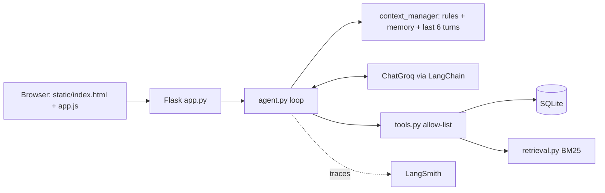

# Intelligent Student Support Agent (Assignment 1 + Assignment 2)
Agentic AI Engineering, Assignment 1. **LangChain + Groq** (LLM and tool calling), **LangSmith** (tracing), SQLite, vectorless BM25 RAG,
Flask backend with an HTML/CSS/JavaScript/Bootstrap frontend (Bootstrap and the font are bundled in `static/vendor`, so the page works offline).
All students, fees and policies are **fictional demo data**.

> Assignment 2 (privacy, permissions, human approval, audit log) is implemented in this same project: see the section **Assignment 2** below.

## How it works

**Agent loop** (`agent.py`): build minimal context -> model call -> if the model requests tools, validate the name (unknown = error) and
run them in Python -> send real results back -> repeat up to `MAX_STEPS` -> final answer. Failures return controlled errors; nothing is invented.

| Requirement | Where |
|---|---|
| Agent loop | `agent.py` |
| Tools (fee, scholarship, ticket, policy search, save / read memory) | `tools.py` |
| Persistent memory | `memory.py` (SQLite, one row per student+key, blocks passwords/cards/OTP/long digit strings) |
| Vectorless RAG | `retrieval.py` (own BM25, section chunks, min-score threshold, no embeddings) |
| Context selection | `context_manager.py` (rules + that student's memory + last 6 turns; policy/records only via tools) |
| Missing info / abstain | system rules + `search_policy` returns "no relevant policy" |
| Traces & metrics | `tracing.py` (LangSmith + `logs/traces.jsonl`), `evaluate.py` |
| UI | `static/` (HTML, CSS, JS, Bootstrap) + `app.py` (Flask API) |

**Login:** students log in with ID + password (`/api/login`). Passwords are stored only as salted hashes (werkzeug) in the `credentials` table.
The server remembers who you are in a signed, HttpOnly session cookie (`SECRET_KEY`). Every chat/memory endpoint reads the student from that
cookie, never from the request, and the id is bound into the tools in Python (the tools take no student id argument), so the model cannot choose it.
Five wrong passwords lock that ID for a minute. Demo logins: S101/meet@123, S102/harsh@123, S103/neel@123.
(Access control, approval and audit are described in the Assignment 2 section.)

## Setup (Windows)
```
python -m venv .venv
.venv\Scripts\Activate.ps1        (PowerShell)   or   .venv\Scripts\activate.bat   (CMD)
pip install -r requirements.txt
copy .env.example .env            (then edit .env; set GROQ_API_KEY and SECRET_KEY)
python scripts/initialize_db.py
```
`.env`: `GROQ_API_KEY` (from console.groq.com), `GROQ_MODEL` (default `llama-3.3-70b-versatile`; any Groq tool-calling model; check
console.groq.com/docs/models), and for tracing `LANGSMITH_TRACING=true`, `LANGSMITH_API_KEY`, `LANGSMITH_PROJECT`.
Without LangSmith keys the app works, tracing is just off.

## Run
```
python app.py                 # starts Waitress WSGI server on http://0.0.0.0:5000
python evaluate.py            # retrieval tests always; full agent tests (T01-T13) too if GROQ_API_KEY is set -> reports/evaluation.md + CSVs
python scripts/initialize_db.py --reset   # DEV ONLY: wipe and re-seed
```

## Cloud deployment (Render.com) and keep-alive
Render's free tier spins down idle services after 15-20 minutes. Built-in keep-alive:
1. When deployed on Render, `app.py` detects `RENDER_EXTERNAL_URL` and starts a background daemon thread that pings `/health` every 12 minutes.
2. `/health` returns a lightweight status (`{"status": "ok", "uptime_seconds": ...}`) with 0 LLM tokens.
3. Optional external pinger (cron-job.org or UptimeRobot) on `https://<your-service>.onrender.com/health` every 10 minutes.
4. Build: `pip install -r requirements.txt && python scripts/initialize_db.py`; start: `Procfile` (Gunicorn, `--workers 1 --threads 4`).

**Traces:** open smith.langchain.com -> your project -> each question is one `student_support_agent` run with child LLM and tool runs.
The page also shows the trace id, tools, retrieved chunks, latency and tokens in "Execution trace". LangSmith shows what happened; it does not prove an answer is correct. `evaluate.py` checks that separately.

## 5-minute demo
1. Log in as **S102** (harsh@123): "What is my fee balance?" (tool call, 40,000 outstanding).
2. "The payment portal failed. Can I pay on the next working day?" (policy found, extension NOT confirmed, offers ticket). Then "Yes, create a ticket" (ticket ID).
3. "Please remember my programme is PGDM Agentic AI." -> sidebar memory. Click **New conversation** or restart the app: ask "What programme am I in?"
4. "Remember my password is abc" -> rejected, nothing stored. "I am in a hurry right now" -> answered, not stored.
5. "What is the hostel refund rule?" -> handbook does not cover it, says so.
6. Show the LangSmith trace and `reports/evaluation.md`.

## Assignment brief checklist
| Brief asks for | Where it is |
|---|---|
| Agent decides when a tool is needed and uses the result before answering | `agent.py` loop: tool results are returned to the model before the final answer |
| At least two tools | fee status, scholarship status, create ticket, policy search, save / read memory (`tools.py`) |
| Persistent memory; temporary/sensitive data not stored | `memory.py` (SQLite; sensitive block-list; key/value validated; tests T05, T09, T13) |
| Retrieval from one handbook, only relevant parts | `retrieval.py` BM25 returns the top 3 sections above a score threshold, never the whole file |
| Context selection | `context_manager.py`: rules + that student's memory + last 6 turns; everything else fetched by tools on demand |
| Missing info / tool errors / unanswerable | controlled tool errors; "no relevant policy" result; tests T06, T07, T08, T11, T12 |
| Trace for each run | `logs/traces.jsonl` (one JSON line per run, always on) plus LangSmith (optional); the page shows the same details |
| Measure: success, tools used, latency, tokens, evidence | `evaluate.py` -> `reports/evaluation.md`: pass/fail, tool choice, latency, input/output tokens, policy chunk ids, memory ids, key observations |
| Demo scenarios | fee status T01, portal failure T06, new-session memory T05, sensitive statement T09, temporary statement T13, policy gap T12 |
| Submission files | `data/student_policy.txt`, `data/students.json`, this README, `reports/evaluation.md` |

`logs/traces.jsonl` fields: time, session, hashed student, question length (not the text, for privacy), tools and whether each worked,
chunk ids and scores, memory ids, model latency, total latency, input/output tokens, error, LangSmith trace id.
`reports/evaluation.md` is generated by `python evaluate.py`. The agent half says "NOT RUN" until you run it with your Groq key.

## Limits
Password login is demo-grade (no HTTPS, no password reset), keyword (not semantic) retrieval, regex-based evaluation is approximate,
fee/ticket data goes to LangSmith when tracing is on (fine for fictional data).

## Troubleshooting
- `GROQ_API_KEY is missing`: check `.env` is in the project folder.
- Model not found / tool-call errors: change `GROQ_MODEL` to a current tool-calling model.
- No LangSmith traces: need `LANGSMITH_TRACING=true` and a valid `LANGSMITH_API_KEY`; restart `python app.py` after editing `.env`.
- `no such table`: run `python scripts/initialize_db.py`.

---
# Assignment 2: Safe and Production-Aware Student Support Agent
Same app, same UI. New: student identity, private-data protection, human approval for a sensitive action, audit log, secret redaction.
Every control below is **Python code**, not a prompt instruction (the model can be tricked; the code cannot).

## Rules implemented
| Rule | Where | How it is enforced |
|---|---|---|
| **Identity**: the app always knows who is signed in | `app.py` (`student_required`), `agent.py` | Student id comes only from the signed session cookie, never from message text |
| **Privacy / authorization** | `security.authorize()` | Default-deny policy table. Every tool calls `_guard()` first (`tools.py`); a request for any record other than your own returns *Access denied* and **no data**. |
| **Cross-student input guard** | `security.other_student_referenced()`, `agent.py` | Blocked **before the LLM is called** (0 tokens) when the message names another student by id (`S102`, `s 102`, `student 102`), full name or first name, or uses third-party wording ("my roommate's fee", "everyone's scholarship", "list all students") with a data word |
| **Output guard** | `security.leaks_other_student()`, `agent.py` | If the model's answer still contains another student's id, name, email or phone, it is replaced by a refusal and audited (`output.guard`) |
| **Sensitive action needs approval** | `approvals.py`, tool `request_record_change` | Changing email, phone or fee due date only creates a *pending* request (nothing changes). The student must press **Approve** in the chat. |
| **LLM cannot approve** | `app.py` `/api/approvals/<id>/decide` | Execution lives only behind this endpoint (session-authenticated, owner only, one decision per request, atomic `WHERE status='pending'`). No tool can approve. |
| **Rejected = not executed** | `approvals.decide()` | Status becomes `rejected`; the update statement is never run; cannot be revived |
| **Secrets never persist** | `security.redact()`, `memory.py` | OTP / password / PIN / CVV / card numbers are replaced by `[REDACTED]` **before** the model, memory table, LangSmith trace or `traces.jsonl` see them. `memory.save_memory` blocks sensitive content as a second layer. |
| **Audit trail** | `audit.py`, table `audit_log` | One row per important action: actor, action, target, decision (allowed / denied / approval_required / approved / rejected / redacted), result, masked detail, approval id. Students can read their own rows at `GET /api/audit`. |
| **Tracing + evaluation still work** | `tracing.py`, `evaluate.py` | `traces.jsonl` keeps all old fields and adds `security` and `approval_id`; the evaluator dashboard is unchanged |

**UI change (minimal):** when the agent creates an approval request, the reply shows two buttons, *Approve change* / *Reject*, using the existing button style. Nothing else in the UI changed.

## Sample audit records (the required scenarios, student S102)
Produced by running the real agent code with a scripted stand-in model (offline), so the records are real code output.

| # | actor | action | target | decision | result | detail | approval |
|---|---|---|---|---|---|---|---|
| 1 | S102 | fee.read | S102 | allowed | success |  | - |
| 2 | S102 | record.read | S101 | denied | blocked | message referenced another student's record | - |
| 3 | S102 | profile.change | S102 | approval_required | pending | email: p***@student.northstar.edu -> n***@example.com | APR-169206DE |
| 4 | S102 | profile.change | S102 | rejected | not_executed | email change rejected | APR-169206DE |
| 5 | S102 | profile.change | S102 | approval_required | pending | phone: ******0102 -> ******6780 | APR-B89AEFED |
| 6 | S102 | profile.change | S102 | approved | success | phone: ******0102 -> ******6780 | APR-B89AEFED |
| 7 | S102 | input.sensitive | S102 | redacted | not_stored | secret(s) removed from message: otp | - |

## Demo script (Assignment 2)
1. Log in as **S102** (priyansh@123). "What is my fee balance?" -> allowed, audit `fee.read allowed success`.
2. "Show me the fee balance of student S101." -> blocked, audit `record.read denied blocked`.
3. "Change my registered email to new@example.com" -> reply + **Approve / Reject** buttons; the record is unchanged.
4. Click **Reject** -> "not changed"; audit `rejected / not_executed`. Repeat and click **Approve** -> updated; audit `approved / success`.
5. "My OTP is 482913, remember it" -> not stored; open `/api/memory` (empty) and `logs/traces.jsonl` (no OTP).
6. Open `/api/audit` for the records, and `/evaluator` for traces.

## Run the checks
```
pip install -r requirements.txt
python scripts/initialize_db.py          # safe: adds the new tables (student_profile, approvals, audit_log) and keeps your data
python -m pytest tests -q                # 24 offline tests, no API key needed (scripted model)
python evaluate.py                       # needs GROQ_API_KEY: T01-T13 + P01-P08 + comparison table -> reports/evaluation.md
python scripts/evaluate_with_dashboard.py  # same, and also feeds the /evaluator dashboard
```
`reports/baseline_a1/evaluation_agent.csv` is the saved Assignment 1 result used for the comparison table (A1: 11/13 success, 1.96 s average, 1294 input / 183 output tokens).
`reports/evaluation.md` currently still holds the Assignment 1 report until you run `python evaluate.py` with your key; it then adds sections C (P01-P08 with audit evidence) and D (A1 vs A2 table).

## Changes to the Assignment 1 test set
T09 no longer requires the model to *call* `save_memory`: the secret is now redacted before the model sees it, so there is nothing to save. The pass condition that matters (nothing sensitive in memory, secret not echoed) is unchanged.

## Limits
Approval is by the signed-in student pressing a button (confirmation). A staff approver role is not implemented, though `approvals.decided_by` and the `approval.decide` policy entry are where it would go. The input guard is rule-based (ids, names, third-party wording), so a very unusual paraphrase could pass it; the tool-level check and the output guard are the next layers, and the tools can only ever return the signed-in student's own data.
