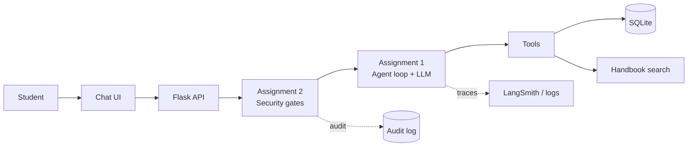

# Northstar University
### Student Support Agent | Agentic AI Engineering

PGDM (Big Data Analytics / AI & Data Science), Batch 2025-27

A chat assistant for a university student portal. Students sign in and ask about fees, scholarships, policies or support tickets. The agent uses tools to look up real data and answers only from what it finds.

> All students, fees and policies are **fictional demo data**.

---

## Two assignments, one project

| | Assignment 1: Intelligent Student Support Agent | Assignment 2: Safe and Production-Aware Agent |
|---|---|---|
| **Goal** | Build a working agent | Make the same agent safe for real use |
| **Agent loop** | Model decides when to call a tool, then answers from the result | Same loop, with security checks around it |
| **Tools** | Fee status, scholarship status, support ticket, handbook search, save and read memory | Same tools, each now permission-checked |
| **Memory** | Remembers facts across sessions, refuses passwords and card numbers | OTPs and passwords are removed before the model, memory or logs see them |
| **Knowledge** | Handbook search with BM25 (no vector database) | Answers must come from the handbook or the student's own records |
| **Privacy** | Student ID fixed by the server | Another student's data is blocked in three layers |
| **Approval** | None | Sensitive changes wait for the student to press Approve |
| **Audit** | None | Every important action is recorded |
| **Tracing** | LangSmith and `traces.jsonl` | Same, plus security decisions |
| **Evaluation** | 13 tests, 11 passed, about 1.96 s per answer | Same tests plus 8 privacy and approval tests, compared with Assignment 1 |

---

## How it fits together



---

## Run it

```bash
pip install -r requirements.txt
python scripts/initialize_db.py
python app.py
```

Open <http://127.0.0.1:5000>. Create a `.env` file first with `GROQ_API_KEY` and `SECRET_KEY`.

Demo login: `S102` / `priyansh@123`

```bash
python -m pytest tests -q    # offline safety tests, no API key needed
python evaluate.py           # full evaluation with the real model
```

---

## Details

- Assignment 1 README: `README_Assignment1.md`
- Assignment 2 README: `README_Assignment2.md`

**Stack:** Python, Flask, LangChain, Groq, LangSmith, SQLite, BM25, HTML / CSS / JavaScript
